# НСУСОСЕД.RU | ОТЧЁТ И РУКОВОДСТВО

Отчёт о созданной версии и руководство пользователя

Сайт nsusosed.ru · MVP

Документ описывает созданную версию сайта, порядок доступа и основные действия пользователя. Сайт помогает студентам НГУ найти соседей по комнате в общежитии или по съёмной квартире — людей, чьи бытовые привычки совпадают с их собственными.

---

# 0. Введение

**Название проекта:** «Соседи по комнате из НГУ, которые живут в твоём ритме» — закрытый сайт для студентов НГУ.

**Доступ к сайту:** https://nsusosed.ru/ — работает в браузере на телефоне и компьютере, установка ничего не требуется. Регистрация возможна только по университетской почте `@g.nsu.ru`.

**Для кого продукт:**

1. **Первокурсники, которые заселяются в общежитие.** Выбирают комнату по тем, кто в ней уже живёт.
2. **Жильцы комнаты, где освободилось место.** Хотят, чтобы въехал человек с похожим режимом.
3. **Студенты, которые снимают квартиру со свободной комнатой.** Хотят найти соседа-студента НГУ.

**Какую проблему решает:**

- **Общежитие.** При заселении комендант называет свободные комнаты по номерам («есть 122, 512, 412 и 302, куда хочешь?»). Студент выбирает, не зная, кто там живёт, и узнаёт, как живут соседи, только после въезда.
- **Съёмная квартира.** Если соседи съехали, оставшийся платит за пустые комнаты. Чаты, листовки, ЦИАН и Авито не помогают найти студента своего вуза.

**Что реализовано:** вход по одноразовому коду на почту без пароля, знакомство с сайтом (онбординг) в зависимости от роли, анкета из 10 вопросов с важностью и принципиальными условиями, карточки жилья (общежитие и квартиры) с админами и приглашениями, подбор жилья по проценту совместимости с объяснением, контакты жильцов в карточке, интерфейс на русском и английском, вёрстка для телефона и компьютера. ИИ-модели не используются: оценка совместимости считается простой формулой.

**Статус:** MVP развёрнут и доступен по адресу nsusosed.ru. Открытые вопросы: финальные формулировки 10 вопросов и шкал ответов; порядок разбора споров между жильцами (например, если админы удаляют друг друга).
---

# 1. Что создано

| Компонент | Назначение |
| --- | --- |
| Вход и регистрация | Почта `@g.nsu.ru`, одноразовый код на 2 минуты, паролей нет. Согласие с политикой обработки персональных данных при регистрации. |
| Онбординг | Знакомство с сайтом, по одному шагу на экран: выбор языка интерфейса и роли («ищу жильё» / «ищу соседа в своё жильё»). |
| Анкета | 10 вопросов о бытовых привычках; по каждому — ответ, важность 1–10 и при желании принципиальное условие. |
| Карточка жилья | Общежитие или квартира: поля, описание, фото, любое число контактов. Жильцы присоединяются по ссылке-приглашению. |
| Админы жилья | Кто добавил жильё, тот его админ. Правят карточку, приглашают соседей, назначают админов, подтверждают карточку раз в 30 дней. |
| Подбор | Список жилья со свободными местами, отсортированный по проценту совместимости, с объяснением; опция «Показать неподходящие». |
| Аккаунт | Смена языка, редактирование анкеты, выход, удаление аккаунта. |
| Инфраструктура | FastAPI + PostgreSQL, чистый HTML/CSS/JS без фреймворков, Nginx, один VPS в Selectel. Письма с кодом — через Yandex Cloud Postbox. |

## Три core-функции

| # | Функция | Готово, когда |
|---|---|---|
| F1 | **Анкета.** Вход без пароля по коду на почту; знакомство с сайтом в зависимости от роли; анкета из 10 вопросов, которую можно изменить | Пользователь может войти по коду, сохранить ответы и изменить их |
| F2 | **Карточка жилья.** Общежитие: корпус, комната, этаж, вместимость, занятые места, угловая или нет, окна, вид, планировка. Квартира: район, стоимость в месяц на человека. Плюс описание, фото и любое число контактов. Жильцы присоединяются по ссылке-приглашению, жильём управляют админы | Жильё создано, жильцы и админы к нему привязаны |
| F3 | **Подбор и контакт.** Отфильтрованный и отсортированный список с объяснением оценки, по желанию — вместе с неподходящим; контакты показаны в карточке | Пользователь видит подходящее ему жильё и может связаться с жильцами |

Также входит в MVP: вход и выход, редактирование и пауза карточки, удаление аккаунта, интерфейс на русском и английском, вёрстка для телефона и компьютера.

---

# 2. Доступ и требования

Перед началом понадобятся:

- действующая почта `@g.nsu.ru` (другие вузы и личные ящики не подходят);
- браузер на телефоне или компьютере и доступ к интернету;
- доступ к почтовому ящику, чтобы получить одноразовый код (код действует 2 минуты).

Установка программ, отдельные логины и пароли не нужны. Оплата не предусмотрена.

---

# 3. Первый вход на сайт

1. Откройте https://nsusosed.ru/ и нажмите кнопку входа по почте `@g.nsu.ru`.
2. На странице входа введите университетскую почту, отметьте согласие с политикой обработки персональных данных и нажмите «Получить код».
3. Дождитесь письма с одноразовым кодом (6 цифр). Код действует 2 минуты.
4. Введите код и нажмите «Войти». Если почта указана неверно, используйте «Другую почту».

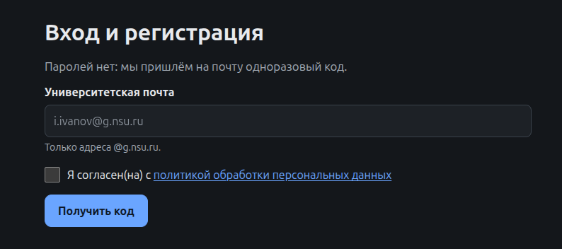
*Рис. 1. Форма входа: поле почты, подпись «только @g.nsu.ru», чекбокс согласия и кнопка получения кода.*

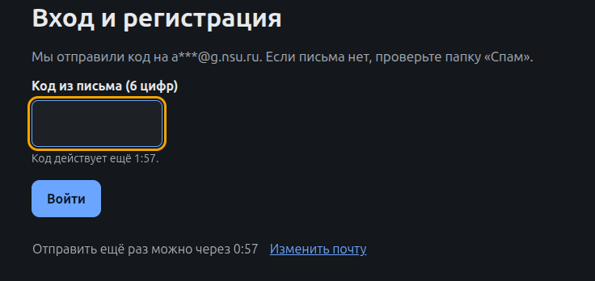
*Рис. 2. Форма ввода 6-значного одноразового кода и кнопка «Войти».*

---

# 4. Знакомство с сайтом (онбординг)

После первого входа сайт проводит вас по короткому сценарию — по одному шагу на экран:

1. **Выбор языка интерфейса.** Русский или английский. Язык можно сменить позже в разделе «Аккаунт».
2. **Выбор роли.** Что вы ищете: **жильё** или **соседа в своё жильё**. От этого ответа зависят все следующие шаги.

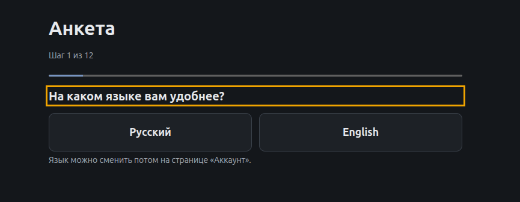
*Рис. 3. Экран выбора языка интерфейса (русский или английский).*

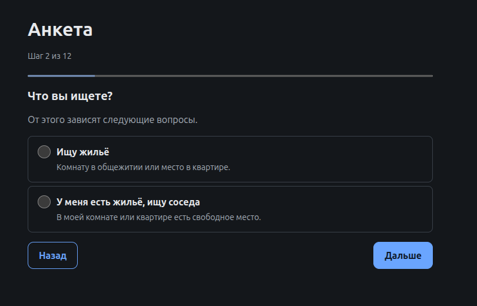
*Рис. 4. Экран выбора роли: «ищу жильё» или «ищу соседа в своё жильё».*

---

# 5. Анкета (core-функция F1)

**Зачем она нужна:** ответы жильцов — единственная основа совместимости. Без заполненной анкеты вас не будет в профиле комнаты, а жильё без анкет жильцов не участвует в подборе.

## Пошаговая инструкция

1. Пройдите анкету из **10 вопросов**: время отхода ко сну, время подъёма, шум ночью, уборка, гости, курение в комнате, алкоголь в комнате, учёба в комнате, проветривание, температура.
2. По каждой привычке укажите:
   - **свой ответ;**
   - **насколько это важно** (шкала 1–10);
   - при желании — **принципиальное условие**: какие ответы соседа для вас неприемлемы (например, «в комнате не курят»).
3. Если вы **ищете жильё**, укажите месячный бюджет (нужен для подбора квартир).
4. Если вы **ищете соседа**, опишите жильё: комнату или квартиру, добавьте сколько угодно контактов, фото и укажите, живут ли там уже соседи. Если живут — получите **ссылку-приглашение** для них.
5. Анкету можно изменить в любой момент в разделе «Аккаунт».

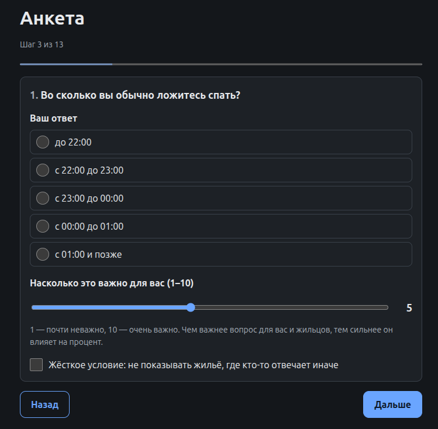
*Рис. 5. Экран одного вопроса анкеты: варианты ответа и шкала важности от 1 до 10.*

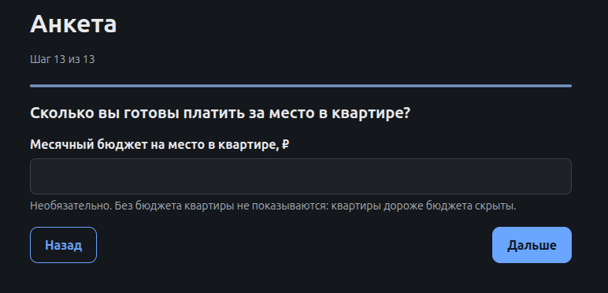
*Рис. 6. Экран ввода месячного бюджета (для роли «ищу жильё»).*

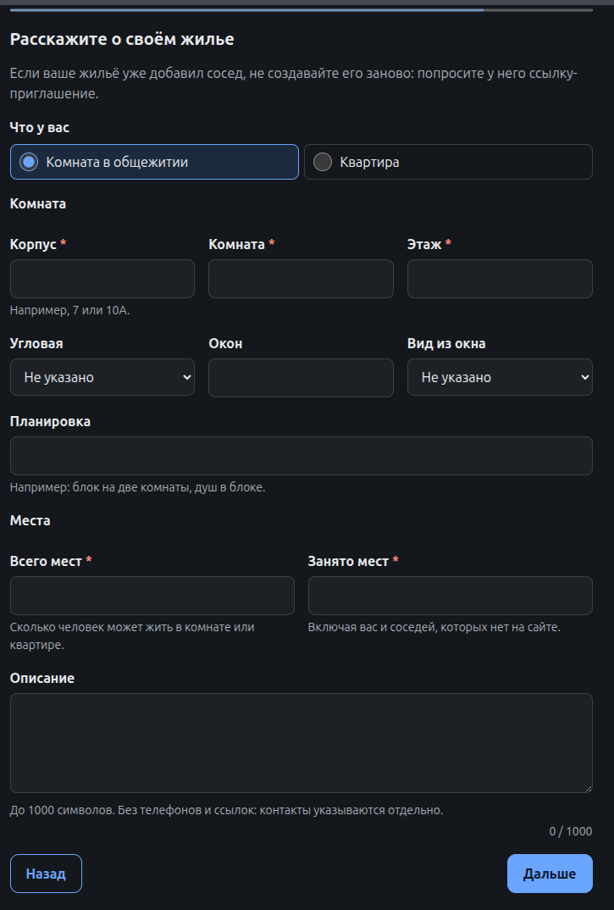
*Рис. 7. Форма добавления общежития: корпус, комната, этаж, вместимость и другие параметры.*

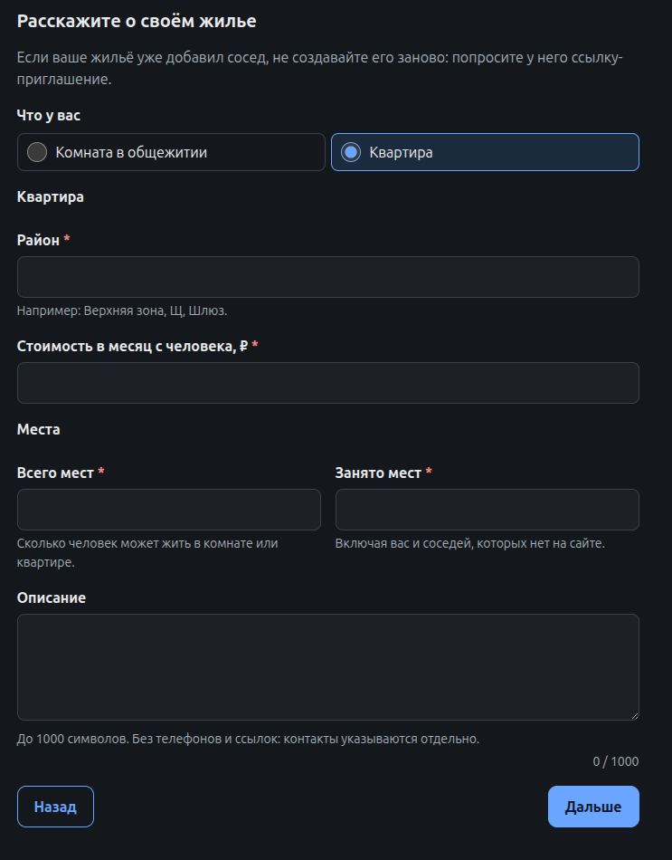
*Рис. 8. Форма добавления квартиры: район, стоимость на человека, описание, фото и контакты.*

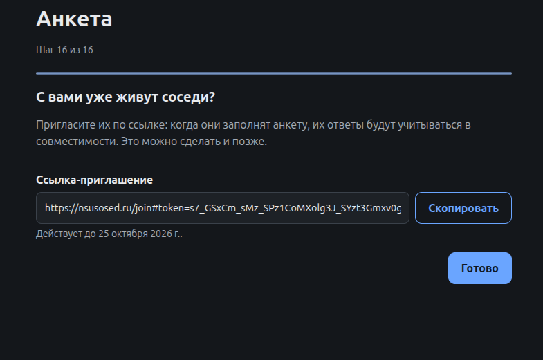
*Рис. 9. Экран с генерацией ссылки-приглашения для текущих или будущих соседей.*

---

# 6. Карточка жилья и админы (core-функция F2)

## Что содержит карточка

- **Общежитие:** корпус, комната, этаж, вместимость, занятые места, угловая или нет, окна, вид, планировка.
- **Квартира:** район, стоимость в месяц на человека.
- **Общее:** описание, фото и любое число контактов жильцов (Telegram, WhatsApp, Max, телефоны и что угодно ещё).

## Правила жилья и админов

- **У жилья есть админы, а не автор.** Кто добавил жильё, тот его админ.
- Админы правят карточку, приглашают соседей и могут сделать админом любого жильца, заполнившего анкету.
- Если уходит последний админ, админом становится тот, кто дольше всех живёт там на сайте. Если уходит последний жилец, жильё удаляется.
- Жить можно **только в одном жилье**, и кто живёт в жилье, тот его не ищет.
- Админ подтверждает карточку **раз в 30 дней**, иначе она скрывается.
- Жильцы присоединяются по **ссылке-приглашению**.

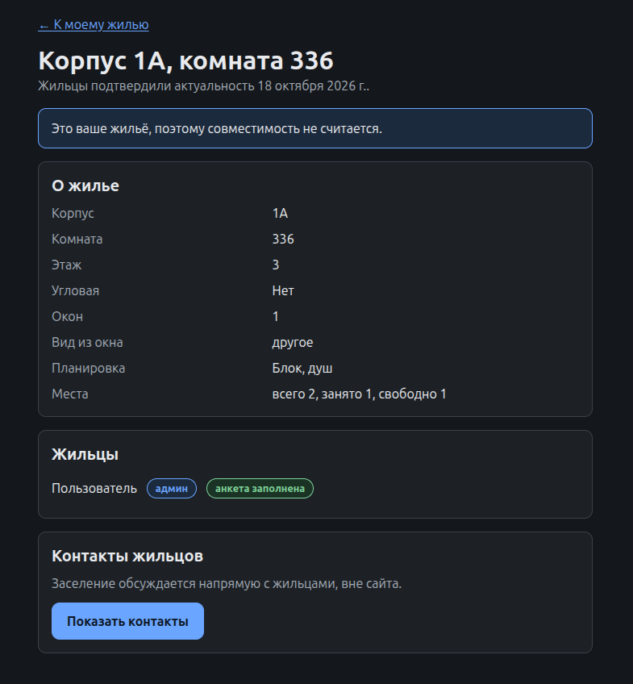
*Рис. 10. Полная карточка жилья: фотографии, основные поля и описание.*

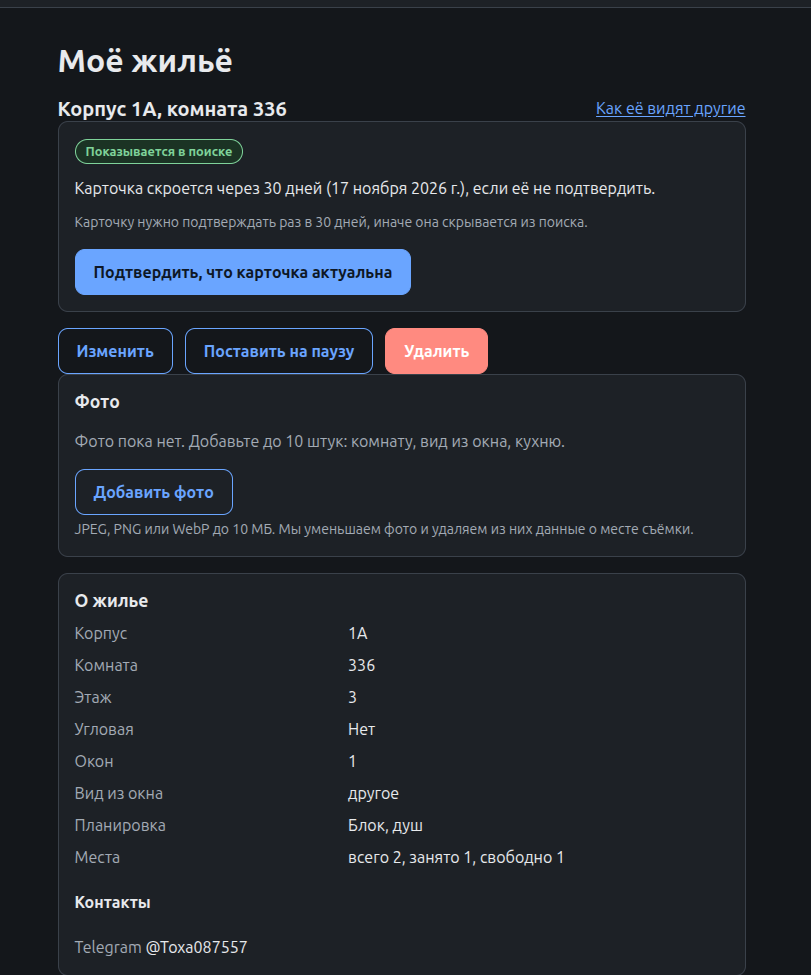
*Рис. 11. Интерфейс админа: редактирование, пауза карточки, подтверждение и управление жильцами.*

---

# 7. Подбор и контакт (core-функция F3)

**Зачем он нужен:** ищущим показывается жильё со свободными местами, отсортированное по проценту совместимости, с коротким объяснением — например, «режим сна совпал, по уборке расхождение».

## Пошаговая инструкция

1. Откройте список подбора: карточки отсортированы по убыванию совместимости, у каждой — процент и объяснение оценки.
2. При желании включите **«Показать неподходящие»**: добавится жильё, которое не проходит по принципиальным условиям или бюджету, — после подходящего и с причиной.
3. Откройте карточку жилья: в ней все контакты, которые указали жильцы. О заселении договариваются **вне сайта**.

## Правила подбора

- **Сначала фильтр по принципиальным условиям, в обе стороны.** Если хотя бы один жилец нарушает ваше условие, или вы нарушаете его условие, жильё скрыто, каким бы высоким ни был средний процент. «Показать неподходящие» всё равно его покажет — после подходящего и с причиной.
- **Квартиры:** скрыты (или, с этой галочкой, помечены), если цена на человека выше вашего бюджета.
- **Анкеты старой версии** продолжают работать: вопрос, на который одна из сторон ещё не ответила, в оценке не участвует.
- **Профиль комнаты:** среднее по жильцам, которые заполнили анкету. Если заполнили не все, в карточке пишется «Ответили 2 из 3 жильцов».
- **Оценка (0–100%):** сходство ответов по каждому вопросу с весом по важности для обеих сторон. Это индекс сходства, а не гарантия отсутствия конфликтов.
- **Не показываются** комнаты без свободных мест, без заполненных анкет жильцов, а также карточки старше 30 дней.

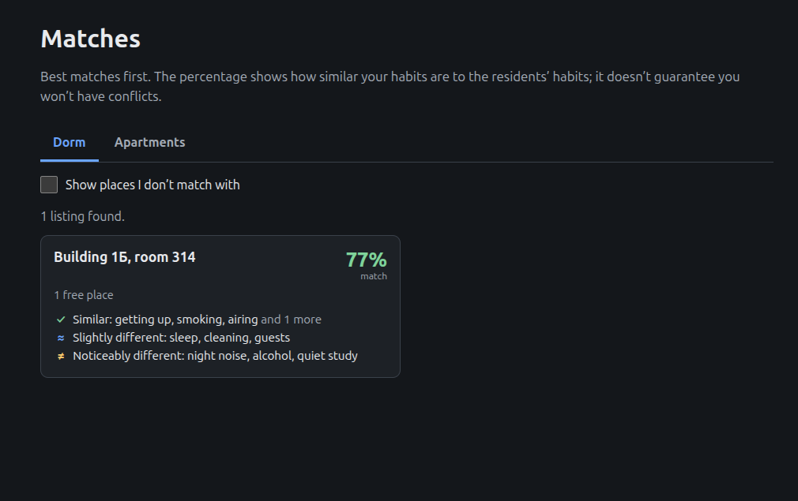
*Рис. 12. Список жилья, отсортированный по проценту совместимости с краткими объяснениями.*

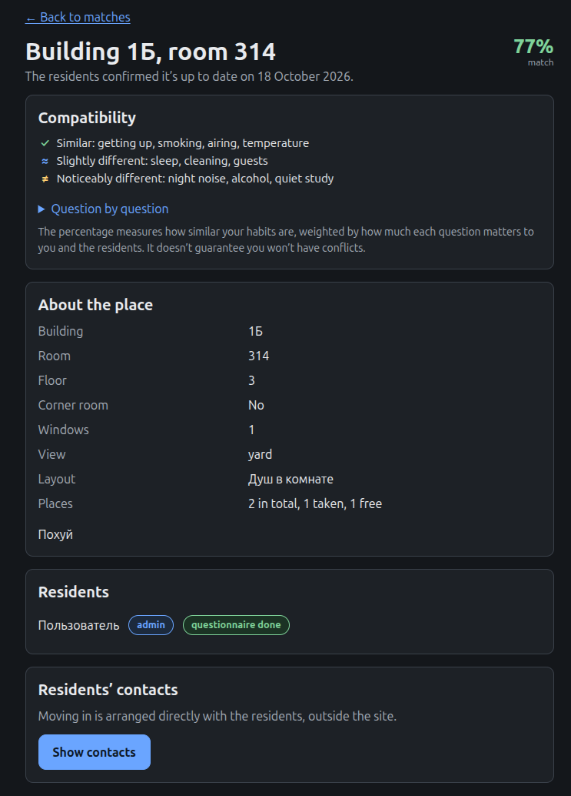
*Рис. 13. Карточка жилья при открытии из метча.*

---

# 8. Аккаунт

В разделе «Аккаунт» доступны:

- смена языка интерфейса;
- редактирование анкеты;
- выход;
- удаление аккаунта.

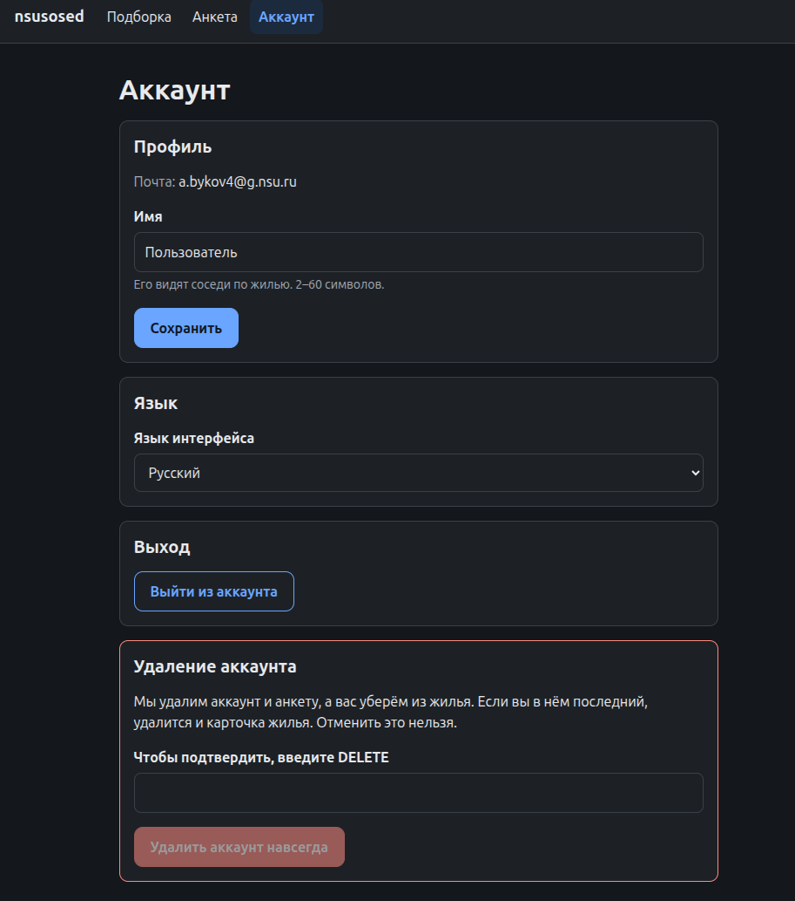
*Рис. 14. Экран аккаунта: настройки языка, редактирование анкеты, выход и удаление аккаунта.*

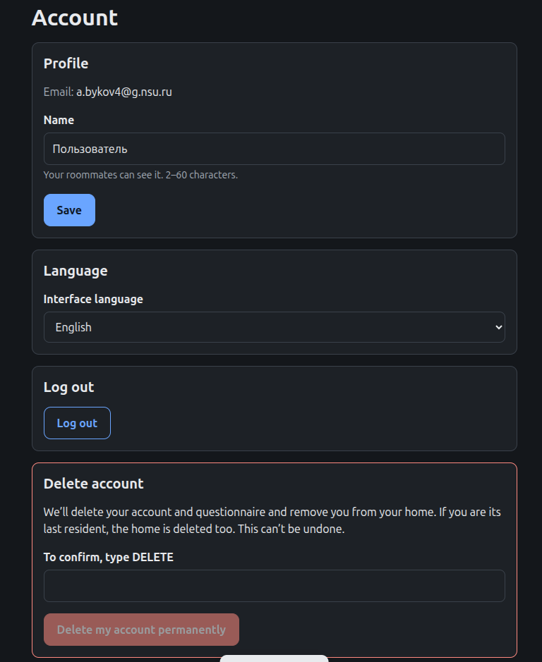
*Рис. 15. Пример экрана интерфейса на английском языке.*

---

# 9. Данные и конфиденциальность

- Сайт **закрытый**: войти можно только по почте `@g.nsu.ru`. Другие вузы не поддерживаются.
- **Паролей нет**: каждый раз на почту приходит одноразовый код, который действует 2 минуты. Письма отправляются через Yandex Cloud Postbox.
- При регистрации пользователь **соглашается с политикой обработки персональных данных**.
- Контакты жильцов видны в карточке жилья; о заселении стороны договариваются вне сайта.
- ИИ-модели не используются: оценка совместимости считается простой формулой.
- Пользователь может **удалить аккаунт**; если уходит последний жилец, жильё удаляется.

---

# 10. Если что-то пошло не так

| Ситуация | Что проверить |
| --- | --- |
| Код не приходит на почту | Адрес должен быть `@g.nsu.ru`; проверьте папку «Спам»; запросите код повторно. |
| Код не принимается | Код действует 2 минуты — запросите новый. Убедитесь, что вводите код из последнего письма. |
| Почта не принимается при входе | Поддерживаются только адреса `@g.nsu.ru`. |
| Жильё не видно в подборе | Возможно: нет свободных мест; жильцы не заполнили анкеты; карточке больше 30 дней и админ её не подтвердил; жильё отсеяно принципиальными условиями или бюджетом — включите «Показать неподходящие», чтобы увидеть причину. |
| Карточка жилья исчезла | Админ не подтвердил её в течение 30 дней — подтвердите или отредактируйте карточку. Также жильё удаляется, если из него ушёл последний жилец. |
| Не получается присоединиться к жилью | Жить можно только в одном жилье. Присоединение идёт по ссылке-приглашению от жильцов; кто уже живёт в жилье, тот его не ищет. |
| Процент совместимости кажется странным | Оценка учитывает только вопросы, на которые ответили обе стороны; важность у всех своя. Проверьте свои ответы и принципиальные условия в анкете. |

---

# 11. Частые вопросы

**Кто может зарегистрироваться?**
Только студенты НГУ с почтой `@g.nsu.ru`. Другие вузы в MVP не поддерживаются.

**Нужен ли пароль?**
Нет. Каждый раз на почту приходит одноразовый код на 2 минуты.

**Что означает процент совместимости?**
Это индекс сходства ответов по 10 вопросам с учётом важности для обеих сторон, а не гарантия отсутствия конфликтов.

**Можно ли жить в двух жилья одновременно?**
Нет. Жить можно только в одном жилье, и кто живёт в жилье, тот его не ищет.

**Что если не все жильцы заполнили анкету?**
Профиль комнаты — среднее по заполнившим; в карточке пишется, например, «Ответили 2 из 3 жильцов». Вопрос, на который одна из сторон не ответила, в оценке не участвует.

**Кто решает, кто въедет в комнату общежития?**
Сайт только помогает договориться: контакты видны в карточке, о заселении договариваются вне сайта. Официальное распределение мест остаётся за комендантом.

**Есть ли встроенный чат, бронирование или оплата?**
Нет, это не входит в MVP.

**Можно ли найти компанию, чтобы вместе снять новую квартиру?**
Нет. Размещаются только существующие квартиры со свободными комнатами.

---

# 12. Что не входит в MVP

- Поиск компании для аренды, пока квартиры ещё нет (размещаются только существующие квартиры со свободными комнатами).
- Встроенный чат, бронирование, официальное распределение мест (решение по-прежнему за комендантом).
- Оплата, в том числе платные объявления о квартирах.
- Другие вузы кроме НГУ; мобильные приложения.

---

# 13. Открытые вопросы

- [ ] Финальные формулировки 10 вопросов и шкал ответов.
- [ ] Споры между жильцами (например, админы удаляют друг друга): кто в команде их разбирает и как пользователю с ним связаться.

---

# 14. Команда

| Имя | Роль |
|---|---|
| Даниил Герман | Бизнес-гипотеза и ценность продукта |
| Никита Безбородов | Архитектура и техническое задание |
| Антон Быков | Разработка и демонстрация MVP |
